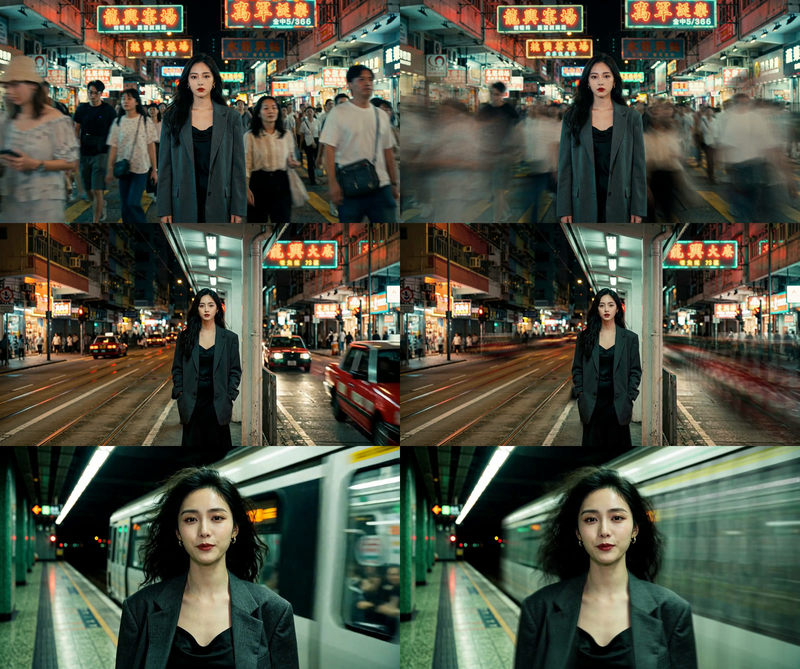
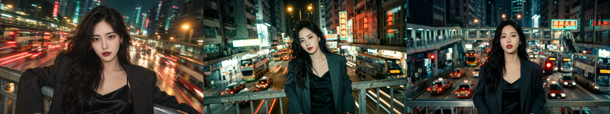

# 王家卫式港风慢门 Skill · wkw-slow-shutter

AI 视频一次生成不出慢门镜头。这个 skill 把它拆成三步，每一步交给 AI 能做好的那部分：

| 效果 | 谁来做 |
|---|---|
| 颜色、胶片颗粒、高光溢出、暗部压死 | 生图模型（一段固定的胶片色调提示词） |
| 拖影、一卡一卡的抽帧 | AI 跑本机 ffmpeg 后期脚本 |
| 唱歌口型 | 能用音频驱动口型的视频模型 |



左：视频模型直接生成　右：同一帧，加了这套后期

## 为什么要拆开

提示词里写了 `slow shutter`，视频模型拍出来还是基本清楚的（实测海螺 H3，只有一点运动模糊）。所以生成这一步只管颜色和构图：**机位锁死，人不动，只让周围动**。拖影和抽帧交给后期，用 ffmpeg 把相邻 10 帧叠成一帧（约 0.4 秒长曝光），再抽成每秒 8 张。唱歌的镜头用椭圆护住脸，只拖背景、不抽帧，口型不乱。

## 颜色



同一个天桥场景、三版提示词，左到右：

| 版本 | 暖色 | 青绿 | 近黑 |
|---|---|---|---|
| GPT Image 2.5 · 早期提示词（用力过度） | 40% | 6% | 6% |
| Nano Banana 2.1 · 早期提示词 | 22% | 15% | 10% |
| Nano Banana 2.1 · 定稿提示词 | 14% | 15% | 19% |

定稿提示词原文、每句管什么、实测出来的主色，都在 [`references/look.md`](references/look.md)。最关键的一句是 `Restrained, natural, not over-processed.`，去掉它画面就会用力过度。

## 怎么用

1. **安装。** Claude Code：
   ```bash
   git clone https://github.com/HunterSUNSUN/wkw-slow-shutter ~/.claude/skills/wkw-slow-shutter
   ```
   其他能运行命令的 AI 助手：按它的方式加载这个文件夹，或者把 `SKILL.md` 发给它。
2. **对 AI 说**：「用 wkw-slow-shutter，把这首歌的 1:25–2:26 做成王家卫风的 MV，主角参考图是 xxx.png」。
3. 它会依次做：分镜表 → 每个镜头一张关键帧（你看过再往下）→ 图生视频 → 慢门后期 → 按帧拼接 → 质检。

## 需要

- ffmpeg、Node.js 18+、Python 3。
- 一个能传人物参考图的生图模型（实测 Nano Banana 2.1）。
- 一个能锁死机位的图生视频模型；有演唱镜头时，还要能用一段歌驱动口型（实测海螺 H3 增强版）。
- 生成要花钱：一分钟成片大约 9 张图加 9 段 5–12 秒的视频。后期、拼接、质检都在本机跑，不花钱。

## 包里有什么

| 文件 | 内容 |
|---|---|
| `SKILL.md` | 完整流程，给 AI 看的 |
| `references/look.md` | 胶片色调提示词原文、每句管什么、实测色值、场景光源怎么写 |
| `references/shots.md` | 镜头设计规则，9 个实测关键帧和视频提示词 |
| `references/post.md` | 后期参数、护脸椭圆怎么定、试过没选的组合 |
| `references/qc.md` | 质检清单 |
| `scripts/post-fx.sh` | 抽帧加拖影、护脸拖影、遮罩预览 |
| `scripts/color-check.py` | 检查一组关键帧的颜色是否一致、是否在实测范围内 |
| `scripts/assemble.js` | 按帧拼接，配原曲，淡入淡出 |
| `scripts/lipsync-check.js` | 演唱镜头口型检查 |
| `examples/slow-shutter/cut.json` | 剪辑表例子 |

## 实测情况

- 用这套做过一条 61 秒、9 个镜头的 MV（《Slow Shutter》英粤版）。用 `post-fx.sh` 对原片重跑，结果和成片里用的片段逐像素一致；用 `assemble.js` 重拼，时长和 8 个剪辑点都和成片一致；三个演唱镜头的口型偏差 0、0、10 毫秒。
- 只实测过九十年代香港夜戏这一种色调、16:9 横屏。竖屏、白天、别的色调都没测过，换之前先出几张样张挑定。

## 说明

- 风格参考王家卫、杜可风的港片夜戏；本项目和他们及其作品没有关联。
- 示例图里的人物是作者用 AI 生成的原创角色，仅作演示。
- 代码、模板和文字采用 [MIT](LICENSE.txt) 许可。作者：我是亨特（小红书 / 抖音 / B 站）。
